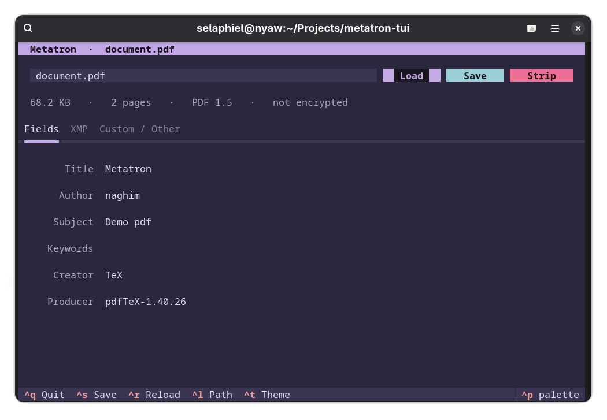

<div align="center">
  
  <h1>Metatron</h1>
</div>

An interactive terminal client with multiple themes for **[Metatron](https://github.com/naghim/metatron)**,
the PDF metadata viewer/cleaner/editor.

`metatron-tui` is a thin [Textual](https://textual.textualize.io/) UI layer on
top of the upstream Metatron engine. It makes
viewing and editing PDF metadata pleasant from the terminal. For the command-line workflow (`metatron info`, `metatron set`, `metatron
clean`, `metatron diff`), install and use the tool directly. All metadata handling (reading, cleaning, and
writing PDFs) lives in the [original project](https://github.com/naghim/metatron).

<p align="center">
  
</p>

## Install

The upstream engine is pulled in automatically as a dependency.

**For use anywhere on your system:**

```bash
uv tool install git+https://github.com/naghim/metatron-tui
```

Then restart your shell (or run `source ~/.bashrc`) so `metatron-tui` is on your
PATH.

**For local development:**

```bash
git clone https://github.com/naghim/metatron-tui
cd metatron-tui
uv sync
```

## Usage

```bash
metatron-tui document.pdf             # open the editor on a file
metatron-tui                          # start empty, then type a path in-app
```

The editor loads a PDF, lets you edit Title / Author / Subject / Keywords /
Creator / Producer, strip all metadata, and browse the read-only XMP and custom
Info keys.

| Key      | Action               |
| -------- | -------------------- |
| `Ctrl+S` | Save changes         |
| `Ctrl+R` | Reload from disk     |
| `Ctrl+L` | Focus the path field |
| `Ctrl+T` | Cycle color theme    |
| `Ctrl+Q` | Quit                 |

Press `Enter` in the path field to load a file.

### Themes

Any Textual built-in theme works: `catppuccin-mocha` (default), `gruvbox`,
`tokyo-night`, `nord`, `dracula`, `solarized-dark`, and more.

```bash
metatron-tui --theme tokyo-night document.pdf
METATRON_THEME=gruvbox metatron-tui document.pdf
```

## File manager integration (XDG)

`metatron-tui` can register itself as an XDG handler for `application/pdf` through
a desktop entry, so it would show up under **"Open With"** in every freedesktop file
manager (GNOME Files, Dolphin, Thunar, PCManFM, …):

```bash
./contrib/install-desktop.sh            # register; keeps your current PDF viewer
```

It uses the standard XDG tools under the hood: `xdg-desktop-menu install`,
`xdg-icon-resource install`, and `update-desktop-database`.
